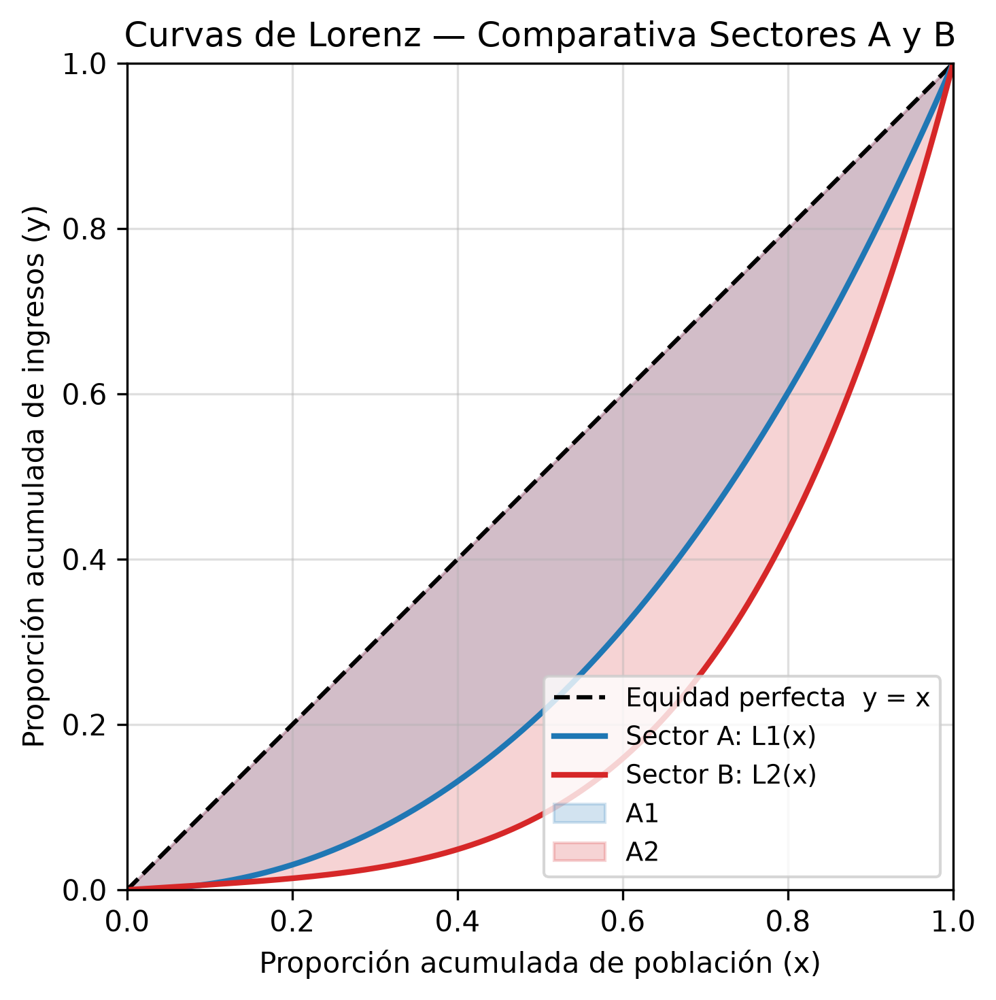

 <div align="center">

# 📊 Curva de Lorenz e Índice de Gini

### Análisis matemático de la desigualdad en la distribución del ingreso

**Proyecto Final · Cálculo II**

Universidad Mariano Gálvez de Guatemala  
Ingeniería en Sistemas de Información

<br>


</div>

---

## 🧭 Acerca del proyecto

Este proyecto desarrolla una herramienta en Python para estudiar y comparar la desigualdad en la distribución del ingreso mediante la **curva de Lorenz y el índice de Gini**.

A través del cálculo simbólico, la integración numérica y las sumas de Riemann, se comprueban los resultados matemáticos de dos modelos de distribución y se generan gráficas que facilitan su interpretación.

### 🎯 Objetivos

- Aplicar los conceptos de integración definida al análisis de la desigualdad.
- Calcular el índice de Gini a partir de funciones de Lorenz.
- Comparar los resultados analíticos con métodos numéricos.
- Representar gráficamente la distribución del ingreso.
- Automatizar los cálculos y generar reportes para su revisión académica.

## 📐 Modelos matemáticos

Se estudian dos funciones de Lorenz correspondientes a los sectores A y B.

| Sector | Función de Lorenz |
|:---:|---|
| **A** | \(L_1(x)=0.7x^2+0.3x^3\) |
| **B** | \(L_2(x)=\frac{15}{16}x^4+\frac{1}{16}x\) |

La referencia para la igualdad perfecta es la recta:

\[
L(x)=x
\]

El área entre esta recta y la curva de Lorenz permite calcular el índice de Gini.

### Fórmulas utilizadas

**1. Área de desigualdad**

\[
A=\int_0^1 [x-L(x)]\,dx
\]

**2. Índice de Gini**

\[
G=2A
\]

El índice de Gini se interpreta en una escala de 0 a 1: un valor más alto representa una mayor desigualdad en la distribución del ingreso.

## 📈 Resultados obtenidos

<div align="center">

| Indicador | Sector A | Sector B |
|:---|:---:|:---:|
| Área de desigualdad | 0.1917 | 0.2813 |
| Índice de Gini | 0.3833 | 0.5625 |
| Nivel de desigualdad | Menor | Mayor |

</div>

### 🔎 Interpretación

El sector B presenta una mayor desigualdad en la distribución del ingreso, debido a que su índice de Gini es superior al del sector A.

La diferencia entre los índices es:

\[
G_B-G_A=\frac{43}{240}\approx0.1792
\]

Este resultado permite comparar ambos modelos mediante un indicador matemático común.

## 🖼️ Visualización de resultados

El programa genera seis gráficas para facilitar el análisis de las funciones y sus resultados.

Cuando ejecutes el código, puedes mostrar las imágenes directamente en este README utilizando las siguientes referencias, siempre que los archivos se encuentren en la carpeta `salida/`.

<div align="center">

| Gráfica | Archivo |
|:---:|---|
| Curva de Lorenz A | `salida/fig1_sector_A.png` |
| Curva de Lorenz B | `salida/fig2_sector_B.png` |
| Comparación de sectores | `salida/fig3_comparativa.png` |
| Brecha de desigualdad | `salida/fig4_brecha.png` |
| Comparación de percentiles | `salida/fig5_percentiles.png` |
| Sumas de Riemann | `salida/fig6_riemann.png` |

</div>

**Vista previa de las gráficas:** puedes incorporar cada imagen con Markdown. Por ejemplo:

```markdown

```

## ⚙️ Tecnologías utilizadas

| Tecnología | Aplicación |
|---|---|
| Python | Desarrollo de la lógica del programa. |
| SymPy | Cálculo simbólico y fracciones exactas. |
| NumPy | Operaciones y cálculos numéricos. |
| Matplotlib | Generación de gráficas. |
| SciPy | Integración numérica y comprobación de resultados. |

## 🚀 Instalación y ejecución

### Requisitos previos

- Python 3.10 o superior.
- Git, para clonar el repositorio.

### 1. Clonar el repositorio

```bash
git clone URL_DEL_REPOSITORIO
cd NOMBRE_DEL_REPOSITORIO
```

Reemplaza los valores anteriores por la URL y el nombre real de tu repositorio.

### 2. Crear un entorno virtual

En Windows PowerShell:

```powershell
python -m venv .venv
.\.venv\Scripts\Activate.ps1
```

### 3. Instalar las dependencias

```powershell
python -m pip install -r requirements.txt
```

### 4. Ejecutar el programa

```powershell
python lorenz_gini.py
```

Al finalizar, el programa genera los resultados y crea la carpeta `salida/` con las gráficas, la tabla de percentiles y el reporte de texto.

## 🧮 Funcionalidades principales

- [x] Definición de funciones de Lorenz con fracciones exactas.
- [x] Verificación de propiedades matemáticas de las curvas.
- [x] Cálculo simbólico del área de desigualdad.
- [x] Cálculo exacto y decimal del índice de Gini.
- [x] Comprobación mediante integración numérica.
- [x] Aproximación mediante sumas de Riemann.
- [x] Generación de tablas de percentiles.
- [x] Exportación de seis gráficas en PNG a 300 dpi.
- [x] Generación de un reporte de resultados.

## 📁 Estructura del repositorio

```text
.
├── lorenz_gini.py
├── requirements.txt
├── README.md
└── salida/
    ├── fig1_sector_A.png
    ├── fig2_sector_B.png
    ├── fig3_comparativa.png
    ├── fig4_brecha.png
    ├── fig5_percentiles.png
    ├── fig6_riemann.png
    ├── tabla_percentiles.csv
    └── resultados.txt
```

> **Nota:** la carpeta `salida/` se crea al ejecutar el programa. Los archivos listados dependen de que la ejecución finalice correctamente.

## 🧪 Comprobación en GeoGebra

También es posible verificar las funciones y las integrales en GeoGebra introduciendo:

```text
L1(x) = 0.7x^2 + 0.3x^3
L2(x) = (15/16)x^4 + (1/16)x
f(x) = x

Integral(f - L1, 0, 1)
Integral(f - L2, 0, 1)
```

## 📚 Referencias

- Stewart, J. *Cálculo*. Consultar el capítulo sobre aplicaciones de la integral definida, según la edición utilizada.
- [Documentación oficial de Python](https://docs.python.org/3/).
- [Documentación de SymPy](https://docs.sympy.org/).
- [Documentación de NumPy](https://numpy.org/doc/).
- [Documentación de Matplotlib](https://matplotlib.org/stable/).
- [Documentación de SciPy](https://docs.scipy.org/doc/scipy/).

---

<div align="center">

**Proyecto académico · Cálculo II**

Universidad Mariano Gálvez de Guatemala

*Ingeniería en Sistemas de Información*

</div>

